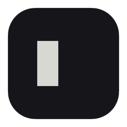

<p align="center"></p>

# ~ Ttylde

[](https://github.com/ttylde/ttylde/actions/workflows/ci.yml)

A terminal emulator for macOS, built around one idea: the terminal should adapt to you, not the other way around. Ttylde is an attempt to put user experience first and build everything else around that.

> !! Early development. Version 0.1 is a terminal you can work in all day; what makes Ttylde its own (spaces, history, favorites, panes) is still ahead. There is no packaged app yet: it runs from source.

VT parsing and the grid are provided by [`alacritty_terminal`](https://crates.io/crates/alacritty_terminal), wrapped behind Ttylde's own interface.

## What works today

- **Tabs** in a sidebar, each with its own session, in the order you drag them to. The sidebar collapses to a rail.
- **Pinned tabs**, seen from every space and started again with the app.
- **Scrollback, selection and copy**: drag, double click for a word, triple click for a line.
- **Mouse and focus reporting** for the programs that ask for them (vim, htop, tmux). Hold Shift to select text anyway.
- **Unicode**: wide characters and combining marks, with glyphs from fallback fonts kept inside their cells.
- **A config file** for the font and the theme colors.

| Shortcut | |
|---|---|
| `Cmd+T` | New tab |
| `Cmd+1` … `Cmd+9` | Go to a tab |
| `Ctrl+1` … `Ctrl+9` | Go to a space, reopening it if it is closed |
| `Ctrl+Tab`, `Ctrl+Shift+Tab` | Next and previous open space |
| `Cmd+\` | Collapse or expand the sidebar |
| `Shift+Enter` | New line without sending, in the programs that support it |

## Configuration

Ttylde reads `~/.config/ttylde/config.toml` (or `$XDG_CONFIG_HOME/ttylde/config.toml`) once at startup. Everything in it is optional; a file with a mistake is reported on stderr and ignored.

```toml
# The shells Ttylde starts (zsh, fish) load its integration, without any of
# your files being changed: each tab knows its last command, and the one
# still running when it closed. `false` starts them exactly as they would.
shell_integration = true

[font]
family = "JetBrains Mono"  # the default: it ships with the app
size = 13                  # between 6 and 72

[theme]
base = "dark"              # "light" (the default) or "dark"
# Any of these replaces the color of the base theme:
foreground = "#d8d8d2"
background = "#16161a"
cursor = "#e8e8e2"
selection = "#3a3f58"
# ansi = ["#000000", ...]  # the 16 ANSI colors, all of them or none

[restore]
# Resuming a space, a command that was running in one of its tabs:
# "ask" (the default) shows a banner that runs it again with Enter,
# "all" runs every one again by itself, "matching" runs again by itself
# what matches a pattern below and asks for the rest.
run = "matching"
match = ["npm run *", "cargo watch *"]  # globs on the whole command

[history]
# Every command that ends is kept, with its folder, space, branch and status,
# for the palette to search. The history of your shell is not touched.
enabled = true
max_entries = 50000                       # the oldest go first
# max_age = "1y"                          # also let go what is older: 30d, 12w, 6m, 1y
secrets_filter = true                     # known keys and tokens: not kept
exclude = ["^export .*="]                 # regexes: commands not kept
exclude_folders = ["~/clients/secret"]    # nothing run in there, or under it, is kept
```

A command typed with a space in front is never kept, as with `HIST_IGNORE_SPACE`. The history is a SQLite file next to the state, `~/.local/state/ttylde/history.db`, that only you can read. Nothing the output of a program prints can pass for a command: the shell signs what it sends with a secret Ttylde gives it.

The app opens on the launcher: the space you were in, ready to resume with `Enter`, the other closed spaces, and a prompt where typing a command starts a new session. Closing the last open space brings it back. Tabs opened while no space is open belong to none, as in a plain terminal, and are not kept across restarts; opening a space asks whether they come along, and **Move to space…** in the menu of a tab moves it, session alive.

Spaces and tabs are kept across restarts in `~/.local/state/ttylde/state.toml` (or `$XDG_STATE_HOME/ttylde/state.toml`), only you can read it: it has the last command of each tab. The app writes it: it is not meant to be edited. A file it cannot read is moved aside to `state.toml.broken`, and the app starts as on a first run.

## Running it

Requirements: Rust (stable), Node.js, [pnpm](https://pnpm.io).

```sh
cd app
pnpm install
pnpm tauri dev
```

A debug build keeps its config, its state and its history in `.dev/` at the root of the repository, out of git, and never touches the files of the installed app: `rm -rf .dev` starts over. It starts with the default config; to change it:

```sh
mkdir -p .dev && cp dev/config.example.toml .dev/config.toml
```

The app icons are generated from `assets/icons/full.png`; after changing it:

```sh
cd app && pnpm icons
```

Tests:

```sh
cargo test --workspace   # core
cd app && pnpm test      # frontend
```

## License

[MIT](LICENSE) © 2026 Alessio Farinelli
